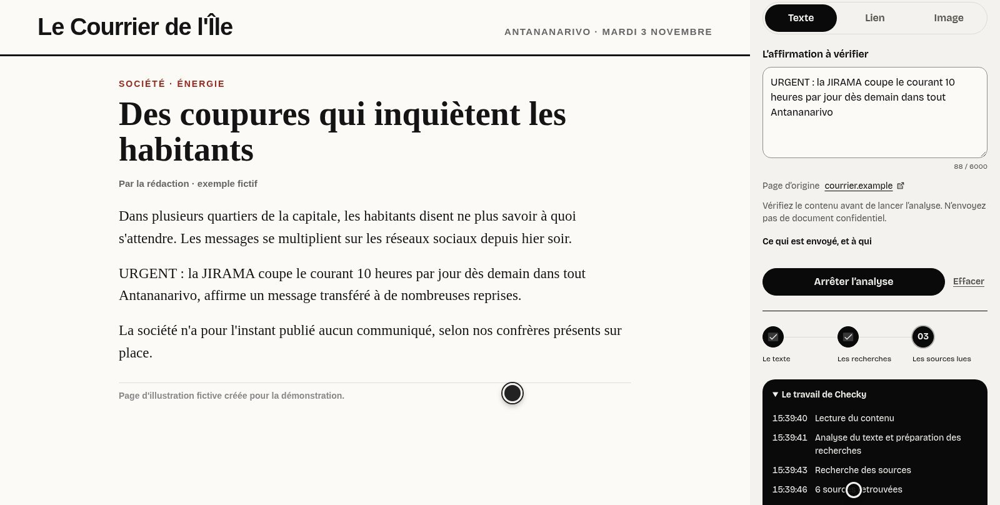
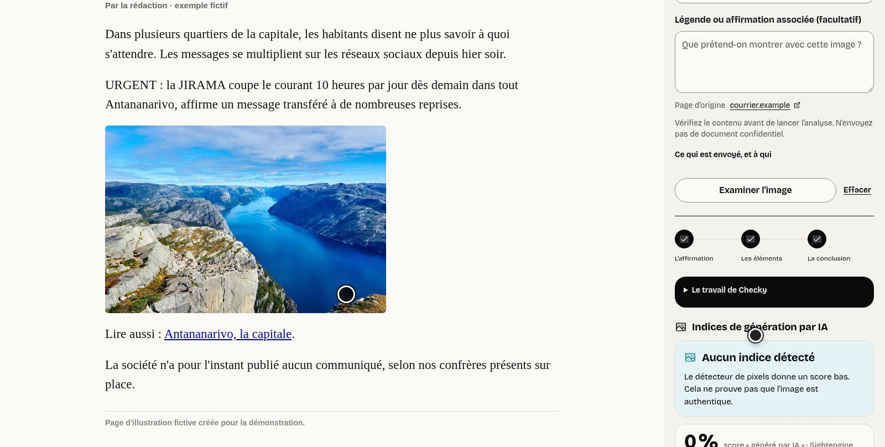

<div align="center">


# Checky — Vérifier ici

**Check a text, a link or an image right where you read it.** No account needed.

[](https://github.com/0nlyDevs/checky-extension/actions/workflows/ci.yml)
[](https://checky-mg.vercel.app)


**[Platform (web + API)](https://github.com/0nlyDevs/checky-platform)** · **[Phone app](https://github.com/0nlyDevs/checky-mobile)** · **[Full reference](docs/REFERENCE.md)**

</div>

---

<table>
  <tr>
    <td width="50%"><br><sub><b>Right-click a sentence.</b> The panel opens beside the page and shows each step as it happens.</sub></td>
    <td width="50%"><br><sub><b>Right-click an image.</b> Metadata, AI-generator markers and reverse-search links, with explicit uncertainty.</sub></td>
  </tr>
</table>

## What it does

Select text on any page and Checky opens **beside it**, with sources and the verdicts that newsrooms have already published. A journalist still decides what to publish; the extension never confirms or publishes a verdict.

| Feature | Details |
|---|---|
| **Right-click to check** | Selected text, a public link or an image, from the context menu, or paste a URL in the panel. |
| **Images without a link** | A WhatsApp photo or a screenshot: choose it, drop it on the panel or paste it. JPEG, PNG, WebP or GIF, up to 5 MB, checked before anything is sent. |
| **Honest evidence** | Related published verdicts with their newsroom and date; external sources opened and quoted word for word; very similar wording flagged as a possible reprise, not as corroboration. |
| **Live stages** | The numbered line *01 L'affirmation → 02 Les éléments → 03 La conclusion* streams what really happens. A search outage is never shown as an empty result. |
| **Image examination** | EXIF and metadata, AI-generator markers, Content Credentials detection and reverse-search links. No marker never means « authentic ». |
| **Veille sur la page** | Off by default. On Facebook and TikTok it badges posts that match a published verdict (« Déjà vérifié · Trompeur ») or one of your newsroom's watched words. |
| **TikTok bubble** | A small Checky disc on the playing video: one tap reads the caption, shows the claim and whether it is already checked. |
| **Newsroom mode** | Optional sign-in to save a dossier, with the original links and the evidence you picked, only after you confirm. |
| **Three languages** | Malagasy, French and English, switched in the panel's settings. |

## Privacy by design

- **No declared content scripts, no access to all sites, no cookie reading, no clipboard monitoring, no history.** The only page script is the watch reader, injected into a Facebook or TikTok tab after you turn it on, and removed when you turn it off.
- The panel previews what it will send and waits for **« Vérifier ce contenu »**. A selection is sent as text only.
- Tokens live in session storage and expire after 15 minutes. Nothing about you is kept in `storage.local` or `storage.sync`.
- Every permission, and what is sent to whom, is listed in the [reference](docs/REFERENCE.md#permissions-and-data).

## Tech stack

| Layer | Technologies |
|---|---|
| **Extension** | Manifest V3, side panel API, context menus, `storage.session` |
| **Language and build** | TypeScript 5.9, Vite 8, no runtime JavaScript framework, fonts packaged locally |
| **API** | The [Checky API](https://github.com/0nlyDevs/checky-platform): public routes `/public/check/stream` and `/public/image-check`, streamed with SSE |
| **Evidence** | Published verdicts, fact-checkers, Tavily, Wikipedia, reverse image search (on the server) |
| **Tests** | `node --test` for the libraries, Playwright browser tests against fictional Facebook and TikTok feeds |
| **CI** | GitHub Actions |

## Install

Needs Node 22.18+, npm and Chrome 116+ (or Edge, Brave).

```bash
npm ci
npm run build
```

1. Open `chrome://extensions` (or `edge://extensions`, `brave://extensions`) and enable **Developer mode**.
2. **Load unpacked** and select this repository's **`dist/`** folder.
3. Pin Checky, select a sentence on any page, right-click and choose **Vérifier ce texte avec Checky**.

To run against a local Checky (web on :3000, API on :8000), use `npm run build:local` and load `dist-local/` instead. Connecting a newsroom, custom deployments and troubleshooting are in the [reference](docs/REFERENCE.md#install-locally).

```bash
npm run check && npm test       # types and unit tests
```

## Documentation

- [`docs/REFERENCE.md`](docs/REFERENCE.md): everything that works, installation, permissions and data handling, limits, browser checks
- [`DESIGN.md`](DESIGN.md): design decisions · [`AGENTS.md`](AGENTS.md): implementation and security conventions

## About

Part of **Checky**, built by team **OnlyDevs** (students at HEI) for the **FANILO Hackathon**, organised by **IFM** and **42** in Antananarivo, 2 to 4 November 2026. This repository does not publish to a browser store.
